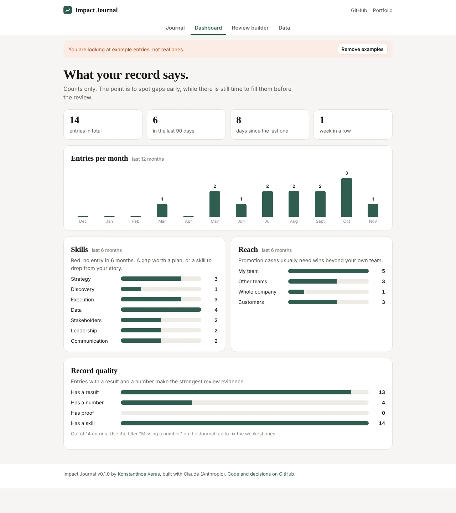

# Impact Journal

**Log work wins with the result they had, see which skills your record is missing, and turn it into a self-review or CV bullets.**

**Current version:** 0.1.0

Live app: https://kostasxeras.com/impact-journal/



## Why this exists

Review season comes and nobody remembers March. Most people write their self-review from memory the night before, so it is thin, recent and missing the numbers. A brag document helps, but a blank document gets abandoned. This app makes the entry small, asks for the result every time, and shows the gaps while there is still time to fill them.

## Who it is for

- Product managers and other knowledge workers who write a self-review once or twice a year
- Anyone preparing for a promotion case, a CV update or a job search
- Managers who want their team to keep a record (each person keeps their own, nothing is shared)

## What it does

- **Journal:** one line for what you did, one for what changed, plus type, reach (my team, other teams, whole company, customers), skills, an optional number, proof link and feedback. Star your best entries.
- **Filters:** search, by skill, starred only, and "missing a number" or "missing a result" to fix weak entries.
- **Dashboard:** entries per month, weeks in a row, skills covered in the last 6 months with gaps in red, reach beyond your own team, and record quality.
- **Review builder:** turns a period (last 3, 6 or 12 months, a quarter or a year) into a self-review by skill (with a "where I want to grow" section for skills with no entries), a summary by type, ranked CV bullets or a one-page brag document. Copy or download as Markdown.
- **Nudge:** after 14 days without an entry, a banner asks if anything is worth a line.
- **Data:** JSON backup and restore, CSV export, your own skill list, and 14 example entries (clearly marked) to try it out.

## Privacy

Everything is stored in your browser's local storage. There is no account and no server of mine. Nothing is sent anywhere. Clearing your browser data deletes it, so the app offers a backup file.

## Decisions

- [Keep everything in the browser, with no account](docs/decisions/0001-browser-storage-only.md)
- [Build drafts from the user's own words, with no AI writing](docs/decisions/0002-drafts-from-your-own-words.md)
- [Show skill gaps first, keep streaks small](docs/decisions/0003-gaps-over-streaks.md)

## How I would measure success

No usage data yet. These are the measures I would track, with targets to set after a first month of use.

| Measure | Definition | Target |
|---|---|---|
| Weekly active writers | Share of users who add at least one entry in 3 of the last 4 weeks | [x]% |
| Entry strength | Share of entries with a result and a number | [x]% |
| Draft use | Share of users who copy or download a draft in review season | [x]% |

## What I would do next

1. Reminders by calendar (once a week, at a time the user picks)
2. Import from a calendar or task tool to suggest entries
3. Optional AI rewording of a draft, shown as a diff against the user's words

## How it was built

I defined the problem, the users, the features and the decisions. Claude (Anthropic) was my engineering partner for the code. The idea started from a small example in Ziplines' list of vibe coding projects, which I turned into a full app with my own product choices.

## Run it yourself

It is one HTML page and one stylesheet, with no build step. Open `index.html` through any local web server, for example `python3 -m http.server`, then go to http://localhost:8000.

## Repo layout

```
index.html               The app
app.css                  Shared base styles
docs/product-brief.md    Problem, users, goals, scope
docs/case-study.md       Approach, decisions, what to measure, next steps
docs/decisions/          One record per real tradeoff
docs/screenshots/        Desktop and mobile
```
